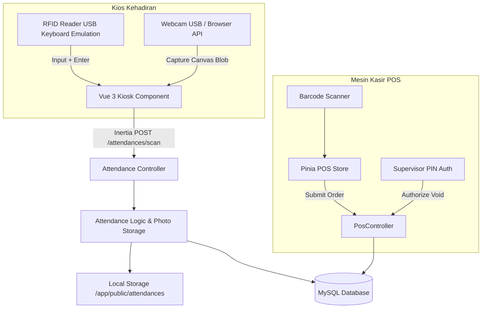
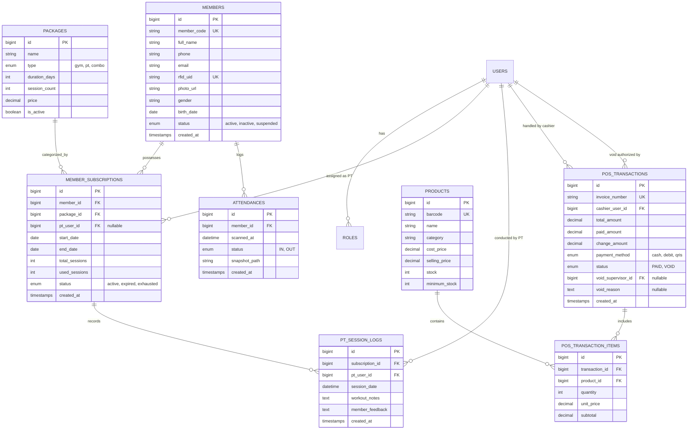
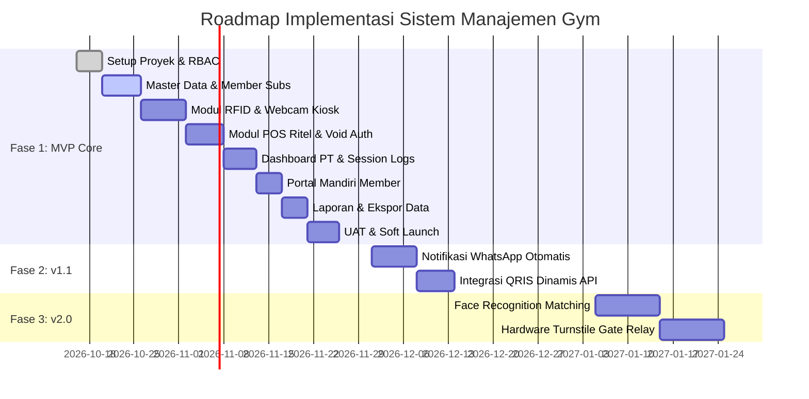

# Product Requirements Document (PRD)
# Sistem Manajemen Gym Terintegrasi

**Document Version:** 1.0.0  
**Status:** Approved / Ready for Development  
**Target Release:** MVP v1.0  
**Stack:** Laravel 13, Vue.js 3 (Composition API), Inertia.js, Tailwind CSS, MySQL  

---

## 1. Executive Summary

### Problem Statement
Operasional harian fasilitas gym saat ini terfragmentasi: pendaftaran anggota dan paket Personal Trainer (PT) seringkali terpisah sehingga menimbulkan duplikasi data, pelacakan sisa kuota sesi PT rentan terhadap *human error* dan manipulasi (*session leakage*), titik penjualan ritel (POS) rentan terhadap pembatalan sepihak tanpa audit supervisor, serta proses check-in manual tidak memiliki bukti verifikasi visual untuk mencegah penyalahgunaan kartu anggota (titip kartu).

### Proposed Solution
Membangun platform **Sistem Manajemen Gym Terintegrasi** berbasis *Single Page Application* (Laravel 13 + Inertia.js + Vue 3) yang menyatukan:
1. Basis data keanggotaan tunggal (*centralized member*) yang mendukung multi-langganan (Gym Reguler & Paket PT).
2. Kios gerbang kehadiran otomatis bertenaga RFID USB dan penangkapan foto webcam lokal secara simultan.
3. Mesin kasir ritel (POS) dengan pemotongan stok atomik dan proteksi pembatalan transaksi (*Void*) berbasis otorisasi PIN Supervisor.
4. Portal khusus Personal Trainer untuk pemotongan kuota sesi dan pencatatan log latihan harian.
5. Portal mandiri (*self-service*) bagi Member untuk memantau masa aktif dan sisa kuota sesi latihan secara transparan.

### Success Criteria (Measurable KPIs)
1. **Kecepatan Check-in Gerbang:** Pemindaian RFID hingga status kehadiran (IN/OUT) divalidasi dan foto webcam tersimpan < **2.0 detik** per orang.
2. **Integritas Sesi Latihan (Zero Session Leakage):** **0% selisih** antara klaim sesi PT dengan catatan di basis data (*pt_session_logs*).
3. **Efisiensi Transaksi POS:** Rata-rata durasi checkout kasir ritel < **15 detik** dengan tingkat akurasi stok **100%** (didukung oleh *Database Transactions*).
4. **Kepatuhan Audit Void:** **100%** transaksi pembatalan kasir wajib menyertakan identitas Supervisor, PIN otorisasi, dan alasan tertulis.
5. **Performa Antarmuka (SPA):** Waktu transisi navigasi antar halaman < **500 ms** tanpa *full-page reload*.

---

## 2. User Experience & Functionality

### 2.1. User Personas

| Persona | Peran & Akses | Tanggung Jawab Utama |
| :--- | :--- | :--- |
| **Administrator (Super Admin)** | Kendali penuh sistem (*full privilege*) | Mengelola master data (alat, paket gym, produk ritel), manajemen akun staf, konfigurasi sistem, dan akses laporan finansial komprehensif. |
| **Supervisor** | Manajer operasional shift | Memantau lalu lintas kehadiran, audit stok barang ritel, menyetujui pembatalan transaksi (*Void/Refund*) di kasir melalui otorisasi kredensial/PIN, dan meninjau ringkasan pendapatan harian. |
| **Customer Service (Frontliner)** | Staf operasional resepsionis & kasir | Mendaftarkan member baru, mengaitkan kartu RFID, memproses penjualan kasir (POS), dan memantau layar kehadiran harian. |
| **Personal Trainer (PT)** | Staf instruktur kebugaran | Mengakses portal PT untuk melihat member asuhan aktif, memotong kuota sesi setelah latihan, dan mengisi log aktivitas latihan. |
| **Gym Member** | Pelanggan terdaftar | Masuk ke portal mandiri (*Member Self-Service*) untuk memeriksa masa aktif keanggotaan, sisa sesi PT, dan histori check-in. |

---

### 2.2. User Stories & Acceptance Criteria

#### Epik 1: Manajemen Akses & Keamanan (RBAC)
- **User Story:**  
  *Sebagai Administrator, saya ingin membatasi akses setiap staf berdasarkan perannya, sehingga fitur sensitif (seperti laporan laba atau tombol hapus data) terlindungi dari penyalahgunaan.*
- **Acceptance Criteria (AC):**
  - [x] Sistem menggunakan `spatie/laravel-permission` untuk otorisasi di level rute (*middleware*), *controller*, dan komponen UI.
  - [x] Portal login tunggal (*unified login*) yang secara otomatis mengarahkan pengguna ke dashboard yang sesuai dengan perannya.
  - [x] Komponen UI sensitif (misal: tombol *Delete*, tab *Laporan Keuangan*) tidak di-render di DOM klien jika pengguna tidak memiliki *permission*.
  - [x] Jika pengguna mencoba mengakses rute yang tidak diizinkan melalui manipulasi URL, sistem mengembalikan status HTTP 403 Forbidden dengan notifikasi yang jelas.

#### Epik 2: Manajemen Member & Langganan Terpusat
- **User Story:**  
  *Sebagai Customer Service, saya ingin mendaftarkan profil member satu kali dan menambahkan paket Gym maupun paket PT secara fleksibel, sehingga tidak terjadi duplikasi entitas member.*
- **Acceptance Criteria (AC):**
  - [x] Entitas `members` menyimpan data unik (Kode Member, Nama, No. HP, Email, RFID UID, Foto Profil).
  - [x] Penambahan paket menggunakan relasi pivot `member_subscriptions` yang menampung paket Gym Reguler, Paket PT, atau keduanya secara bersamaan.
  - [x] Sistem menghitung secara otomatis `start_date` dan `end_date` berdasarkan durasi paket.
  - [x] Untuk paket PT, sistem menginisialisasi `total_sessions` dan menyetel `used_sessions = 0`.
  - [x] Sistem menyediakan fitur pencarian cepat member berdasarkan nama, nomor telepon, atau pemindaian kartu RFID dalam waktu < 300 ms.

#### Epik 3: Kehadiran Otomatis (RFID & Webcam Kiosk)
- **User Story:**  
  *Sebagai Staf Resepsionis, saya ingin pemindai RFID langsung membaca kartu dan webcam mengambil foto otomatis tanpa perlu klik mouse, sehingga verifikasi kehadiran di pintu masuk berlangsung cepat dan terdokumentasi.*
- **Acceptance Criteria (AC):**
  - [x] Antarmuka kios kehadiran memiliki mekanisme *autofocus* otomatis pada *input* RFID setiap saat.
  - [x] Sistem menangkap stream webcam via browser Web API (`navigator.mediaDevices.getUserMedia`) pada resolusi minimum 640x480.
  - [x] Ketika RFID dibaca (menghasilkan string diakhiri event `Enter`), *frontend* mengambil frame foto dari canvas dan mengirimkannya bersama kode RFID dalam 1 payload HTTP POST.
  - [x] *Backend* memvalidasi masa aktif paket member. Jika tidak aktif / kedaluwarsa, akses ditolak dengan visualisasi merah dan nada peringatan (*audio alert*).
  - [x] Jika paket aktif, status kehadiran ditentukan otomatis: **IN** jika belum ada check-in hari ini atau status terakhir adalah OUT; **OUT** jika status terakhir hari ini adalah IN.
  - [x] Foto disimpan ke storage lokal server (`storage/app/public/attendances/YYYY/MM/`) dan tautan file dicatat di tabel `attendances`.
  - [x] Tabel log kehadiran pada layar resepsionis terbarui secara reaktif dalam waktu < **2.0 detik** tanpa memuat ulang halaman (*zero page refresh*).

#### Epik 4: Point of Sale (POS) Kasir & Otorisasi Void
- **User Story:**  
  *Sebagai Kasir, saya ingin memilih produk ritel dan memproses pembayaran secara interaktif, dan sebagai Supervisor, saya ingin memverifikasi setiap pembatalan transaksi agar tidak terjadi kebocoran uang kas.*
- **Acceptance Criteria (AC):**
  - [x] Antarmuka kasir ritel dilengkapi keranjang belanja interaktif berbasis Pinia store dengan kalkulasi instan subtotal, diskon, dan kembalian.
  - [x] Transaksi pembayaran dibungkus dalam *Database Transaction* (`DB::transaction`) yang secara atomik membuat rekaman `pos_transactions`, rincian `pos_transaction_items`, dan memotong `stock` di tabel `products`.
  - [x] Transaksi yang telah selesai tidak dapat dibatalkan langsung oleh Kasir.
  - [x] Tombol "Void" membuka modal verifikasi khusus yang meminta **Email/Username dan PIN Supervisor**.
  - [x] Setelah Supervisor memverifikasi, status transaksi berubah menjadi `VOID`, kuantitas stok dikembalikan (*reverted*) secara otomatis, dan catatan audit (*void log*) disimpan beserta timestamp dan ID Supervisor.

#### Epik 5: Dashboard Personal Trainer & Pemotongan Kuota Sesi
- **User Story:**  
  *Sebagai Personal Trainer, saya ingin memotong kuota sesi member dan mencatat detail program latihan yang telah dilakukan, sehingga progres member tercatat rapi dan hak sesi terpotong secara transparan.*
- **Acceptance Criteria (AC):**
  - [x] Pengguna dengan peran PT memiliki dashboard khusus yang hanya menampilkan daftar member yang sedang aktif dalam paket PT dan ditugaskan (*assigned*) kepadanya.
  - [x] Sistem menampilkan sisa kuota sesi (`total_sessions - used_sessions`) dan tanggal kedaluwarsa paket secara jelas.
  - [x] Tombol "Selesaikan Sesi / Potong Kuota" terkunci (*disabled*) jika kuota sesi tersisa sudah 0 atau paket telah kedaluwarsa.
  - [x] Setiap pemotongan sesi mewajibkan pengisian formulir log aktivitas (`pt_session_logs`), mencakup: durasi latihan, fokus otot/program, catatan evaluasi, dan tanda tangan digital/konfirmasi.
  - [x] Pemotongan kuota menggunakan *atomic increment* (`used_sessions + 1`) dengan *row-locking* untuk mencegah *race condition*.

#### Epik 6: Portal Mandiri Member (Member Self-Service)
- **User Story:**  
  *Sebagai Member, saya ingin masuk ke portal web untuk mengecek status keanggotaan dan riwayat pemotongan sesi PT saya, sehingga saya tahu sisa sesi latihan tanpa harus bertanya ke resepsionis.*
- **Acceptance Criteria (AC):**
  - [x] Member dapat melakukan otentikasi menggunakan kredensial akun mereka (Email/No. HP dan Password).
  - [x] Tampilan kartu keanggotaan digital (*Digital Membership Card*) menampilkan status aktif, tanggal kedaluwarsa, dan barcode/RFID ID.
  - [x] Menu rincian paket PT menampilkan grafik persentase sesi terpakai dan daftar histori log aktivitas yang diisi oleh pelatih mereka.
  - [x] Portal bersifat *read-only* terhadap data transaksional dan operasional gym.

#### Epik 7: Analitik & Pelaporan Finansial
- **User Story:**  
  *Sebagai Administrator & Supervisor, saya ingin melihat metrik operasional dan mengekspor laporan pendapatan, sehingga evaluasi performa gym dapat dilakukan secara akurat.*
- **Acceptance Criteria (AC):**
  - [x] Dashboard analitik menyajikan KPI kartu: *Total Member*, *Member Aktif*, *Member Saat Ini di Ruangan (In-Gym)*, dan *Rasio Gender*.
  - [x] Grafik pendapatan interaktif dapat difilter berdasarkan rentang tanggal dan kategori pemasukan:
    - Langganan Gym Reguler
    - Paket Personal Trainer
    - Penjualan Kasir POS Ritel
  - [x] Fitur ekspor laporan tersedia dalam format **PDF** dan **Excel (.xlsx)** dengan ringkasan subtotal dan rincian transaksi.

---

### 2.3. Non-Goals (Batasan Ruang Lingkup MVP)
Berikut adalah fitur yang **TIDAK** disertakan dalam fase MVP v1.0 untuk menjamin fokus dan kecepatan rilis:
1. **Payment Gateway Auto-Recurring:** Pembayaran keanggotaan tidak terhubung ke auto-debit kartu kredit berkala. Transaksi diproses di kasir via Tunai, Mesin EDC manual, atau QRIS statis.
2. **Aplikasi Native Mobile (iOS / Android Store):** Tidak mengembangkan aplikasi native (.apk / .ipa). Seluruh akses mobile menggunakan Web Responsive SPA (Inertia.js + Vue).
3. **Turnstile / Barrier Gate Hardware Relay Trigger (IoT):** Tidak mencakup perakitan controller mikrokontroler (Arduino/ESP32) untuk membuka palang pintu mekanik secara otomatis. Verifikasi gerbang difokuskan pada layar kios resepsionis dengan audio buzzer browser dan audit visual webcam.
4. **Multi-Cabang (Multi-Tenancy):** Sistem dirancang untuk operasional satu fasilitas gym (*single gym branch*).
5. **Telemetri Alat Gym Otomatis:** Tidak ada integrasi sensor nirkabel pada beban atau treadmill.

---

## 3. AI & Automation Requirements

### Otomatisasi & Logika Cerdas (Heuristics)
Meskipun sistem belum menggunakan Model Bahasa Besar (LLM) di inti transaksi finansial demi menjaga determinisme data, sistem menerapkan otomatisasi berikut:
1. **Status Kehadiran Deterministik (Toggle State Machine):**
   - Logika: `f(RFID, CurrentDate) -> if last_state == 'IN' then 'OUT' else 'IN'`.
2. **Pendeteksi Anomali Check-in Ganda (Anti-Passback Sederhana):**
   - Jika kartu RFID yang sama dipindai kembali dalam rentang waktu < 60 detik, sistem mengeluarkan peringatan suara dan visual (*Duplicate Scan Alert*) tanpa merekam log ganda.
3. **Rencana AI v2.0 (Roadmap):**
   - *Face Comparison*: Pengecekan otomatis kesesuaian antara foto webcam saat check-in dengan foto master member untuk mendeteksi kecurangan titip kartu (*confidence score >= 85%*).

---

## 4. Technical Specifications

### 4.1. Architecture Overview
Arsitektur monolit modern menggunakan pola **Inertia.js Monolith**:
- **Backend:** Laravel 13 (Routing, Controllers, Eloquent ORM, Database Transactions, Authorization Policies).
- **Client Presentation:** Vue.js 3 (Composition API `<script setup>`) yang dirender langsung via Inertia tanpa perlu membangun REST API terpisah untuk CRUD internal.
- **State Management:** Pinia untuk modul keranjang POS dan status pemindaian gerbang.
- **Styling & UI/UX Design System:** Mengadopsi **Sash Enterprise Admin Design System** ([DESIGN.md](file:///g:/1.%20IBNU%20JS/gms/tamplate/DESIGN.md)):
  - **Palet Warna:** Canvas dasar netral `#f0f3fb`, card permukaan putih solid `#ffffff` dengan border halus `#e9edf4` dan drop shadow multi-layer. Aksen warna semantik: Primary Violet (`#6c5ffc`), Secondary Teal (`#09ad95`), Cyan Telemetri (`#03c892`), Sky Blue (`#05c3fb`), Amber Warning (`#f7b924`), dan Coral/Crimson Error/Void (`#ba1a1a`).
  - **Tipografi:** Google Fonts **Plus Jakarta Sans** (Display, Headline, Body) dipadukan dengan **Inter** untuk label navigasi, tombol, dan data tabular (`font-feature-settings: "tnum" 1, "cv05" 1`).
  - **Ikonografi:** Google Material Symbols Outlined.
  - **Struktur Layout:** 12-kolom grid fluida, sidebar navigasi vertikal 260px (`w-64`), sticky header bar 64px, serta radius sudut kartu 12px (`rounded-xl` / `0.75rem`).
  - **Referensi Template Prototipe:** Prototipe desain dashboard gym telah diintegrasikan pada [dashboard_gym.html](file:///g:/1.%20IBNU%20JS/gms/tamplate/dashboard_gym.html).

### 4.2. Database Schema & Key Entities

### 4.3. Integration Points
1. **USB Hardware Keyboard Emulation (RFID):**
   - Pemindai RFID bertindak sebagai peranti HID keyboard. Input teks otomatis mengisi elemen `<input id="rfid-listener" autofocus>` dan memicu event `@keydown.enter`.
2. **Browser MediaDevices API:**
   - Akses kamera: `navigator.mediaDevices.getUserMedia({ video: { width: 640, height: 480 } })`.
   - Snapshot dibuat via `<canvas>` element menggunakan `drawImage(video, 0, 0)` dan dikonversi ke format WebP/JPEG blob berukuran < 100 KB.
3. **Inertia.js Protocol:**
   - Navigasi SPA mulus dengan memanfaatkan XHR headers (`X-Inertia: true`).

### 4.4. Security & Data Privacy
- **Otorisasi Ketat:** Controller dilindungi oleh `$this->authorize('permission_name')` dan rute grup dilindungi oleh middleware `role:admin|supervisor|cs|pt`.
- **Integritas Void:** PIN Supervisor disimpan dalam bentuk hash `bcrypt` dan hanya diverifikasi melalui endpoint backend terenkripsi HTTPS.
- **Penyimpanan Foto Kehadiran:** Folder penyimpanan foto dilindungi direktori terstruktur dan nama file diacak menggunakan UUID untuk mencegah manipulasi URL langsung.
- **Proteksi Transaksi Finansial:** Setiap perubahan inventaris stok dan mutasi kuota sesi PT wajib dijalankan dalam `DB::transaction()` dengan `lockForUpdate()` pada entitas terkait.

---

## 5. Risks & Phased Roadmap

### 5.1. Phased Rollout Plan

- **Fase 1 (MVP v1.0 - Target Durasi 5-6 Minggu):**
  - Fondasi Laravel 13, Vue 3, Inertia, Spatie RBAC.
  - CRUD Member, Paket Langganan tunggal & combo (Gym + PT).
  - Kios Kehadiran RFID + Webcam snapshot dengan audio feedback.
  - Modul Kasir POS dengan otorisasi Void Supervisor.
  - Dashboard Personal Trainer & pemotongan kuota sesi terisolasi.
  - Portal Mandiri Member (cek masa aktif dan riwayat kuota).
  - Dashboard Analitik dan Ekspor Laporan (PDF & Excel).

- **Fase 2 (v1.1 - Pasca-Peluncuran):**
  - Pengiriman pesan WhatsApp otomatis (konfirmasi registrasi, notifikasi potong sesi PT, peringatan H-3 masa aktif habis).
  - Integrasi API Payment Gateway untuk QRIS Dinamis langsung di layar kasir.

- **Fase 3 (v2.0 - Ekspansi Enterprise):**
  - AI Face Matching: Pencocokan otomatis wajah webcam dengan foto profil member saat tap RFID.
  - Integrasi Turnstile Gate IoT: Sinyal relay pembuka palang gerbang otomatis via serial/MQTT.

---

### 5.2. Technical Risks & Mitigations

| Risiko Teknis | Dampak | Probabilitas | Strategi Mitigasi |
| :--- | :--- | :--- | :--- |
| **Kehilangan Fokus Input RFID (Focus Lost):** Staf mengeklik area lain di browser sehingga pembacaan RFID tidak tertangkap input. | Kios macet; member tertahan di gerbang. | Tinggi | Pasang *global keyboard event listener* pada window untuk menangkap stream input RFID terlepas dari elemen yang sedang aktif, atau gunakan script interval auto-refocus ke elemen input tersembunyi. |
| **Akses Webcam Terputus / Diblokir:** Izin browser dicabut atau kabel USB kamera terlepas. | Foto kehadiran gagal disimpan. | Sedang | Tampilkan indikator visual status kamera di sudut kios (*Green/Red badge*). Jika kamera terputus, izinkan check-in darurat dengan mencatat status flag `snapshot_missing: true` dan tampilkan modal peringatan ke resepsionis. |
| **Race Condition pada Kuota PT:** PT mengeklik tombol potong kuota berkali-kali secara simultan. | Kuota berkurang ganda (*over-deduction*). | Rendah | Terapkan *button debouncing* di sisi Vue, serta gunakan `lockForUpdate()` dan pengecekan sisa kuota di dalam *Database Transaction* sebelum melakukan increment `used_sessions`. |
| **Penyimpanan Foto Membengkak:** Ribuan foto check-in membebani kapasitas disk lokal server. | Server kehabisan ruang penyimpanan. | Sedang | Kompresi foto ke format WebP dengan *quality factor* 75% (< 60 KB/foto). Buat *Laravel Scheduled Command* mingguan untuk membersihkan foto kehadiran yang berumur > 90 hari kecuali ditandai penting. |
| **Ketidaksesuaian Stok Kasir:** Kasir memproses barang yang bersamaan diedit stoknya oleh admin. | Data stok minus atau tidak konsisten. | Rendah | Validasi ketersediaan stok tepat di dalam `DB::transaction()` sebelum *commit*. Jika stok < kuantitas permintaan, batalkan transaksi dan beri pesan kesalahan instan ke kasir. |

---

## 6. Sign-off & Persetujuan Dokumen

| Stakeholder | Peran | Status | Tanggal |
| :--- | :--- | :--- | :--- |
| **Product Owner / Gym Management** | Pemilik Produk & Visi Bisnis | Disetujui | 15 Oktober 2026 |
| **Lead Software Engineer** | Arsitektur & Teknis | Disetujui | 15 Oktober 2026 |
| **Head of Operations / Supervisor** | Validasi Alur Operasional & Void | Disetujui | 15 Oktober 2026 |
